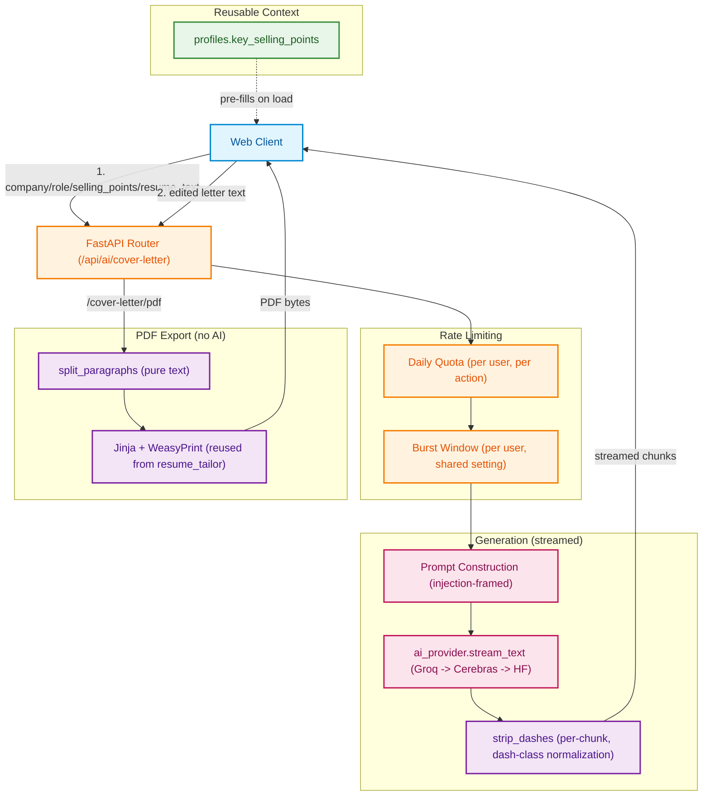

# Cover Letter: High-Level Architecture (HLD)

**Document Version:** 1.0.0
**Status:** Approved for Production
**Target Audience:** Staff Engineers, Systems Architects, Backend Engineers

---

## 1. Executive Overview

**Cover Letter** is a single-purpose streaming generation tool: given a company, role, the candidate's own selling points, and optionally resume text, it streams back a tailored cover letter in real time, then lets the user export it as a PDF. Unlike Resume Tailor, there is no deterministic matching/scoring layer and no persisted session — this is intentionally the simpler end of the tool spectrum, hardened to the same production bar without inheriting architecture it doesn't need.

### Key Architectural Objectives
1. **Streamed, Editable Output**: the letter streams token-by-token into an editable textarea — the user can correct anything before copying, downloading, or saving it, so content correctness leans on user review plus deterministic guardrails rather than a heavy validation pipeline.
2. **Defense Against a Scraped-Data Injection Surface**: `company`/`role` can originate from a Startup Hunt opportunity (scraped/AI-extracted external data), not just the user's own typing — the generation prompt explicitly treats all four input fields as data to write *about*, never instructions to follow.
3. **No New Infrastructure for PDF Export**: reuses resume_tailor's already-installed WeasyPrint/Jinja stack for a single simple one-page layout, instead of building (or depending on) a new rendering pipeline or a new dependency like `python-docx`.
4. **Shared, Reusable Candidate Context**: a profile-level default ("Default Selling Points") lets a user set their pitch once and reuse it across every letter, editable per-application without touching the saved default.

---

## 2. System Topology & Architecture Diagram

---

## 3. High-Level Component Responsibilities

| Component | Module Location | Responsibility |
| :--- | :--- | :--- |
| **API Router** | `routes.py` | Both endpoints: streamed generation and PDF export. Rate limiting, prompt construction, stream error handling. |
| **Text Utilities** | `text.py` | Pure, dependency-free helpers: `strip_dashes` (dash-class normalization) and `split_paragraphs` (PDF layout prep). Deliberately has zero WeasyPrint/AI imports so it stays independently testable — same reason resume_tailor keeps its own `rendering.py` isolated from its AI/generation logic. |
| **Rendering** | `rendering.py` | PDF export only: Jinja + WeasyPrint, reusing resume_tailor's already-installed stack. No AI, no content changes. |
| **Schemas** | `schemas.py` | `CoverLetterRequest` (generation input, all fields length-capped) and `CoverLetterPdfRequest` (export input). |
| **Profile (shared module)** | `app/modules/profile/` | Owns `profiles.key_selling_points` — the reusable default this tool reads but never writes to directly. |
| **AI Provider (shared)** | `app/ai/llm/provider.py` | `stream_text` — the Groq → Cerebras → HF fallback chain, circuit breaker, and (as of this module's hardening pass) `reasoning_effort` support and `finish_reason` truncation logging on the streaming path. |

---

## 4. Key Architectural Patterns & Guarantees

### 4.1 No Persistence, By Design
There is no `cover_letters` table and no session concept. A generated letter lives only in the browser until the user copies, downloads, or (if triggered from a Startup Hunt lead) it gets opportunistically saved as an artifact on that lead. This is a deliberate scope boundary, not an oversight — see `docs/cover_letter/data_flow_and_schema.md` for the reasoning and what it would take to add history.

### 4.2 Streaming Error Handling Without a Wire-Protocol Redesign
`StreamingResponse` commits to HTTP 200 the moment the body iterator starts, before any exception from inside it can be turned into a proper 4xx/5xx. Rather than redesign the protocol, a failure mid-generation (provider exhaustion, network error) is caught and a clearly-bracketed notice is appended to the stream itself — visible in the editable textarea, and trivially deletable by the user, instead of a silent cutoff with no explanation.

### 4.3 Two-Layer Defense Against the Dash Character Class
The generation prompt explicitly instructs the model never to use em dashes, en dashes, or non-standard hyphens — but style instructions alone are not reliably honored (the same lesson that led to `response_format=json_object` elsewhere in this codebase). `text.py::strip_dashes` is a deterministic backstop applied to every streamed chunk, normalizing the full Unicode dash class (hyphen, non-breaking hyphen, figure dash, en dash, em dash, horizontal bar, minus sign) to a plain ASCII hyphen — found live after the prompt-only fix still let `U+2011` (non-breaking hyphen) through.

### 4.4 Prompt-Injection Framing for a Partially-Untrusted Input Surface
`company`/`role` can be pre-filled from a Startup Hunt opportunity — scraped/AI-extracted external data, not the user's own typing. The system prompt explicitly frames all four input fields as data describing a candidate and a job, never as instructions, and tells the model to treat anything that reads like a command inside them as literal text to write about.

---

## 5. Security & Compliance Safeguards

1. **Input length caps on every field**: `company`/`role` (200 chars), `selling_points` (3,000), `resume_text` (8,000), PDF `content` (5,000) — all previously unbounded, a direct DoS and prompt-injection-cost vector per CLAUDE.md's input-length rule.
2. **Split rate limiting**: a daily AI-generation quota, a separate daily PDF-export quota (no LLM cost, but real WeasyPrint CPU cost under concurrent load), and a shared burst window on both — fails open on a Redis error, consistent with every other limiter in this codebase.
3. **Prompt-injection framing**: see §4.4.
4. **No secrets/PII in logs**: only character counts and exception reprs are logged on a stream failure, never prompt content.
