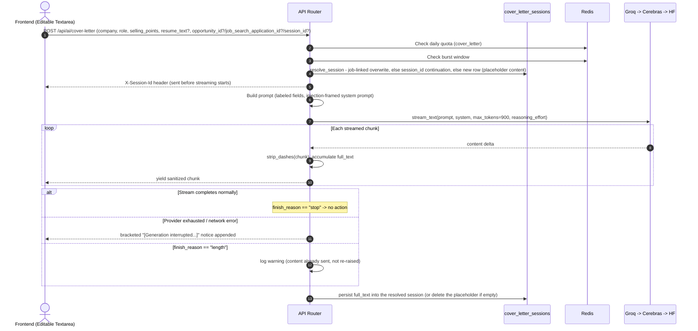
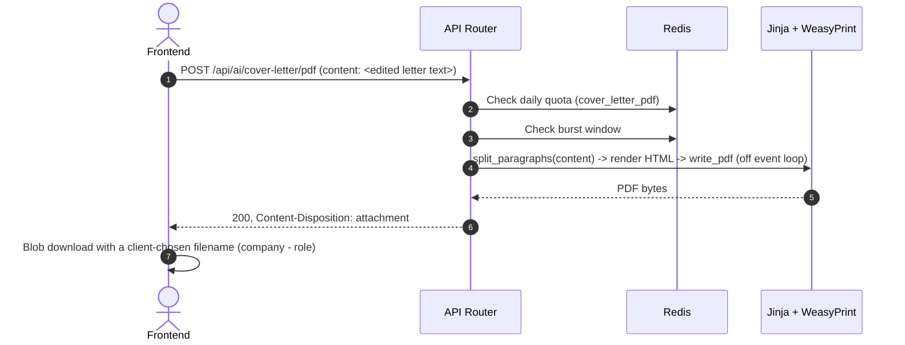

# Cover Letter: Data Flow & Schema Reference

**Document Version:** 1.0.0
**Status:** Approved for Production

---

## 1. Database Schema

Every successful generation auto-persists into a `cover_letter_sessions` row (see `service.py::resolve_session`) - the user can also download it as a PDF, copy it, or (if the session was opened from a Startup Hunt lead) it gets opportunistically saved as a `startup_hunt_opportunities` artifact via that module's own `/artifacts` endpoint (frontend-triggered, not something this module writes to directly).

### 1.1 `cover_letter_sessions`

Unlike resume_tailor's resume+JD hash, a cover letter has no deterministic content-based dedup key, so the row this generation lands in is resolved by identity instead: a job-linked generation (`source_opportunity_id`/`source_application_id` present) overwrites the one existing session already linked to that job - "only one saved letter per job" - while an ad-hoc generation upserts by a client-held `session_id` for the current browser visit only. Mirrors `tailoring_sessions`' `source_opportunity_id`/`source_application_id` linkage pattern (same ON DELETE SET NULL reasoning) so "My Docs" can group a resume and a cover letter saved for the same job.

```sql
CREATE TABLE cover_letter_sessions (
    id UUID PRIMARY KEY DEFAULT uuid_generate_v4(),
    created_at TIMESTAMPTZ NOT NULL DEFAULT now(),
    user_id UUID NOT NULL REFERENCES profiles(id) ON DELETE CASCADE,
    company TEXT NOT NULL CHECK (char_length(company) <= 200),
    role TEXT NOT NULL CHECK (char_length(role) <= 200),
    selling_points TEXT NOT NULL CHECK (char_length(selling_points) <= 3000),
    resume_text TEXT,
    content TEXT NOT NULL CHECK (char_length(content) <= 5000),
    title TEXT CHECK (title IS NULL OR char_length(title) <= 200),
    source_opportunity_id UUID REFERENCES startup_hunt_opportunities(id) ON DELETE SET NULL,
    source_application_id UUID REFERENCES job_search_applications(id) ON DELETE SET NULL
);
```

- No `ai_status`/`ai_provider`/`ai_error` columns - only a successfully-generated letter ever becomes a row (a totally-failed generation deletes its own placeholder row instead), so there's nothing to track on the row itself.
- No unique constraint - the upsert rule in §1 above is enforced in application code (`get_by_source`/`session_id` lookup), not a DB constraint.
- `title` - user-renameable via `PATCH /api/ai/cover-letter/sessions/{id}/title`, same UX as resume_tailor's My Docs (rename only - no delete, no re-edit-and-resave).

### 1.2 `profiles.key_selling_points` (shared with the Profile module)

The one piece of durable state this module reads (never writes directly):

```sql
ALTER TABLE profiles ADD COLUMN key_selling_points TEXT;
```

- Nullable, no length constraint at the DB level (consistent with every other `profiles` CV-extension column — `work_authorization`, `nationality`, etc. — none of which have DB-level `CheckConstraint`s either).
- Enforced at the application layer: `app/modules/profile/service.py::update_profile` rejects a value over 3,000 characters (matching the cover-letter form's own cap on the field this feeds into) via an inline length guard, since this module has no Pydantic request schema (`update_profile` takes a raw `dict`, filtered through an allowlist).
- Written only from the Profile page (`PUT /api/profile`). The Cover Letter page reads it once on load to pre-fill `selling_points` and never writes back to it — editing the field for one letter never touches this saved default.

---

## 2. Redis Keys

### 2.1 Rate Limiting (daily quotas)
- **Generation**: `rl:{user_id}:cover_letter` — `rate_limit_cover_letter_per_day` (default 5).
- **PDF export**: `rl:{user_id}:cover_letter_pdf` — `rate_limit_cover_letter_pdf_per_day` (default 20). Separate from generation because this call has real CPU cost (WeasyPrint) but zero LLM cost — see `architecture_lld.md` §3.1.

### 2.2 Burst Limiting (shared window, both endpoints)
- Keyed per `(user_id, tool)` using the shared `rate_limit_burst_limit`/`rate_limit_burst_window_seconds` settings — same sliding-window-log implementation (`app/services/cache.py::check_burst_limit`) every other tool in this codebase uses.

### 2.3 Single-Flight Lock (concurrency safety, not rate limiting)
- `cover_letter_gen:{user_id}:lock`, TTL 60s (`app/services/cache.py::acquire_lock`) — rejects a second concurrent `/cover-letter` request from the same user with `429` rather than letting both proceed and either double-spend AI cost or create duplicate `cover_letter_sessions` rows. Released explicitly via `delete_cached` the moment this request's own work ends, not left to the full TTL. See `production_hardening_playbook.md` §1 for why burst limiting alone doesn't cover this.

### 2.4 AI Provider Circuit Breaker (shared, not cover-letter-specific)
- `_CIRCUIT_SCOPE = "ai_llm"` in `app/ai/llm/provider.py` — a single scope shared across *every* tool and *every* user. Cover Letter's generation calls participate in this exactly like every other `ai_provider.generate_text`/`stream_text` caller; there is no per-tool circuit breaker to configure here.

---

## 3. Data Flow Diagrams

### 3.1 Generation



### 3.2 PDF Export


