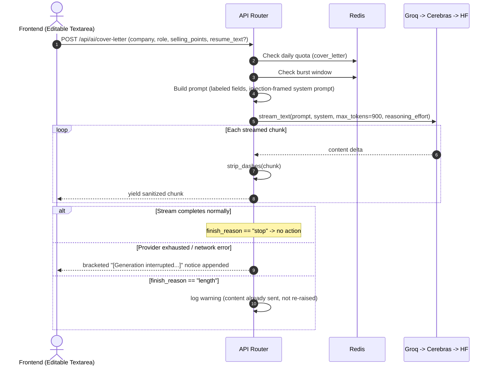
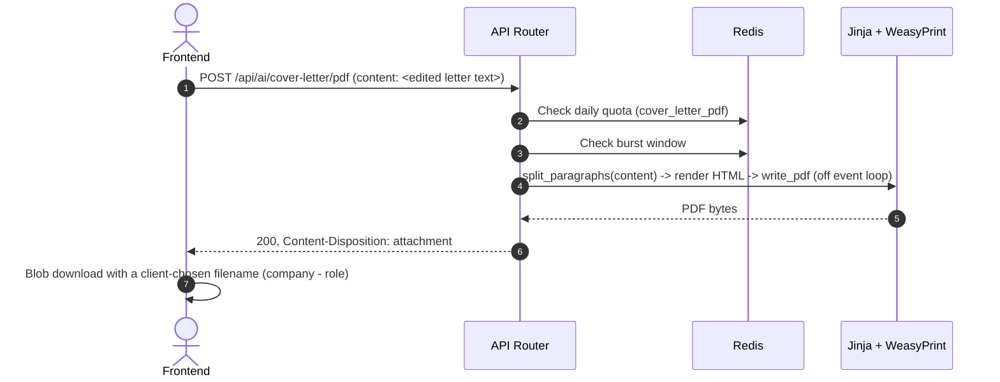

# Cover Letter: Data Flow & Schema Reference

**Document Version:** 1.0.0
**Status:** Approved for Production

---

## 1. Database Schema

**There is no dedicated table for this module.** A generated letter is never persisted server-side — it exists only in the browser's editable textarea until the user copies it, downloads it as a PDF, or (if the session was opened from a Startup Hunt lead) it gets opportunistically saved as a `startup_hunt_opportunities` artifact via that module's own `/artifacts` endpoint (frontend-triggered, not something this module writes to directly).

This is a deliberate scope boundary, not an oversight: a cover letter is typically single-use per application, lower-stakes to lose than a resume, and adding a history view would be a real feature (new table, routes, UI — mirroring resume_tailor's "My Docs") rather than a hardening fix. See `docs/cover_letter/architecture_hld.md` §4.1.

### 1.1 `profiles.key_selling_points` (shared with the Profile module)

The one piece of durable state this module reads (never writes directly):

```sql
ALTER TABLE profiles ADD COLUMN key_selling_points TEXT;
```

- Nullable, no length constraint at the DB level (consistent with every other `profiles` CV-extension column — `work_authorization`, `nationality`, etc. — none of which have DB-level `CheckConstraint`s either).
- Enforced at the application layer: `app/modules/profile/service.py::update_profile` rejects a value over 3,000 characters (matching the cover-letter form's own cap on the field this feeds into) via an inline length guard, since this module has no Pydantic request schema (`update_profile` takes a raw `dict`, filtered through an allowlist).
- Written only from the Profile page (`PUT /api/profile`). The Cover Letter page reads it once on load to pre-fill `selling_points` and never writes back to it — editing the field for one letter never touches this saved default.

---

## 2. Redis Keys

### 2.1 Rate Limiting (daily quotas)
- **Generation**: `rl:{user_id}:cover_letter` — `rate_limit_cover_letter_per_day` (default 5).
- **PDF export**: `rl:{user_id}:cover_letter_pdf` — `rate_limit_cover_letter_pdf_per_day` (default 20). Separate from generation because this call has real CPU cost (WeasyPrint) but zero LLM cost — see `architecture_lld.md` §3.1.

### 2.2 Burst Limiting (shared window, both endpoints)
- Keyed per `(user_id, tool)` using the shared `rate_limit_burst_limit`/`rate_limit_burst_window_seconds` settings — same sliding-window-log implementation (`app/services/cache.py::check_burst_limit`) every other tool in this codebase uses.

### 2.3 AI Provider Circuit Breaker (shared, not cover-letter-specific)
- `_CIRCUIT_SCOPE = "ai_llm"` in `app/ai/llm/provider.py` — a single scope shared across *every* tool and *every* user. Cover Letter's generation calls participate in this exactly like every other `ai_provider.generate_text`/`stream_text` caller; there is no per-tool circuit breaker to configure here.

---

## 3. Data Flow Diagrams

### 3.1 Generation



### 3.2 PDF Export


