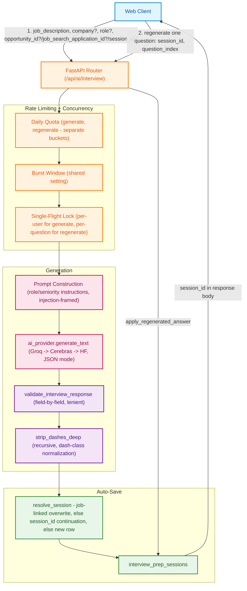

# Interview Prep: High-Level Architecture (HLD)

**Document Version:** 1.0.0
**Status:** Approved for Production
**Target Audience:** Staff Engineers, Systems Architects, Backend Engineers

---

## 1. Executive Overview

**Interview Prep** turns a job description into a tailored prep kit: a role assessment (seniority, role family, likely interview rounds, hedged company-reputation context), 10 behavioral/situational/technical questions with STAR-method answer guides, and — only when the detected role plausibly warrants them — a small set of DSA-style and system-design prep questions with an "approach" guide rather than a full worked solution. Any single answer can be regenerated independently. Every successful generation auto-persists so the user never loses a kit to a forgotten save click.

### Key Architectural Objectives
1. **Role-Aware, Not One-Size-Fits-All**: the same 10-question behavioral mix every JD got before this tool's hardening pass is now paired with a seniority/role-family assessment that calibrates answer depth, plus conditionally-generated technical prep (DSA/system design) only for roles that plausibly have those rounds — a Marketing Manager JD gets none, an AI/ML Engineer JD gets both.
2. **Defense Against Fabrication, Not Just Injection**: the system prompt explicitly forbids inventing a company's actual confidential interview process or a specific fact the JD didn't provide — `company_context` is either a hedged, well-known public reputation note or `null`, never an invented specific claim. Confirmed live: given a fictional company name with no public reputation, the model correctly returned `null` rather than fabricating one.
3. **Auto-Save, Upserted By Job Link or Browser Visit**: same pattern as Cover Letter (see `docs/cover_letter/architecture_hld.md` §4.1) — a job-linked generation overwrites the one existing kit for that job; an ad-hoc generation upserts by a client-held `session_id` for the current visit. A regenerated answer is patched back into the saved kit too, so My Docs never shows a stale answer next to a kit's other, unregenerated ones.
4. **Shared AI Infrastructure, No New Dependencies**: reuses the same provider chain, circuit breaker, and JSON-mode hardening pattern (`response_format=json_object` + field-by-field schema validation) already proven in Resume Tailor and Cover Letter — no new AI provider, no new rendering stack.

---

## 2. System Topology & Architecture Diagram

---

## 3. High-Level Component Responsibilities

| Component | Module Location | Responsibility |
| :--- | :--- | :--- |
| **API Router** | `routes.py` | Both generation endpoints: rate limiting, single-flight locking, prompt construction, JSON extraction/validation, session resolution. |
| **Saved-Session Routes** | `sessions_routes.py` | My Docs read-only CRUD: list, get-one, rename. No create endpoint — creation is folded into generation (see §4.1). |
| **Prompts** | `prompts.py` | `INTERVIEW_SYSTEM_PROMPT` (role assessment + question-mix rules, anti-fabrication, prompt-injection framing) and the two prompt builders. |
| **Schemas** | `schemas.py` | Request bounds (`InterviewPrepRequest`, `InterviewRegenerateRequest`) and the lenient response validators (`validate_interview_response`, `validate_regenerate_response`) that guard against a syntactically-valid-but-wrong-shape LLM response. |
| **Text Utilities** | `text.py` | `strip_dashes`/`strip_dashes_deep` — dash-class normalization applied recursively to every string in the generated JSON, zero AI/DB imports so it stays independently testable. |
| **Models / Repository / Service** | `models.py`, `repository.py`, `service.py` | `InterviewPrepSession` (one table), its repository (incl. `get_by_source` for the job-linked upsert lookup), and `resolve_session`/`apply_regenerated_answer`/`list_sessions_for_docs_page`/the two ownership checks. |
| **AI Provider (shared)** | `app/ai/llm/provider.py` | `generate_text` — the Groq → Cerebras → HF fallback chain, shared circuit breaker, JSON mode, `reasoning_effort`. |

---

## 4. Key Architectural Patterns & Guarantees

### 4.1 Auto-Save, No Separate Create Endpoint
There is no `POST /interview/save`. `POST /interview` both generates the kit and persists it in the same request — `service.py::resolve_session` runs after the result is validated, using the same job-link-overwrite-or-session-continuation upsert rule Cover Letter uses (see `docs/cover_letter/architecture_hld.md` §4.1), and the response body includes `session_id` directly (no streaming here, so no response-header trick is needed the way Cover Letter needs one). `POST /interview/regenerate` optionally takes that same `session_id` plus a `question_index`, and patches the regenerated answer back into the saved kit's `result.questions[question_index]` so a saved kit never drifts out of sync with what the user last saw.

### 4.2 Conditional Technical Prep, Not a Fixed Shape
`role_assessment.dsa_likely`/`system_design_likely` are LLM-determined booleans, not user-selectable toggles — the model decides based on the actual role described, and `dsa_questions`/`system_design_questions` are empty arrays when neither applies. This was deliberately NOT hardcoded by role-title keyword matching (e.g. "if title contains 'Engineer'") — a JD's actual described responsibilities are a better signal than its title, and keyword matching would both over- and under-trigger (a "Site Reliability Engineer" title with no coding round described, vs. a "Technical Program Manager" JD that explicitly mentions a system-design round).

### 4.3 Two-Layer Defense Against Fabrication and the Dash Character Class
Same two established patterns from Resume Tailor/Cover Letter, applied here: (a) the system prompt explicitly forbids treating a well-known company's general reputation as license to invent specific confidential process details, and forbids inventing a company name when none is identifiable — confirmed live, a fictional "Acme Software Inc" produced `company_context: null` rather than a fabricated note; (b) `strip_dashes_deep` recursively normalizes the full Unicode dash class across every string in the response (not just top-level fields) as a deterministic backstop, since a prompt instruction alone isn't reliably honored (the same lesson Cover Letter's own `strip_dashes` exists for).

### 4.4 Lenient, Field-Scoped Response Validation
`response_format={"type": "json_object"}` only guarantees syntactically valid JSON, not the right shape or the right literal values. `validate_interview_response`/`validate_regenerate_response` (built on a shared `_validate_against_schema` helper) validate one top-level field at a time, falling back to that field's own default on a mismatch rather than discarding the whole response. This caught a real bug during development: the prompt's own question-mix instruction asks for "2 motivational" questions, but an earlier, stricter `Literal["STAR", "Behavioral", "Technical", "Situational"]` on the `framework` field didn't include `"Motivational"` — one mismatched tag was silently wiping the entire 10-question list down to `[]`. Fixed by relaxing `framework` to free text (it's a cosmetic display tag the frontend doesn't branch on) while keeping `seniority`/`dsa_likely`/`system_design_likely` strict, since the frontend's rendering genuinely depends on those being exactly right.

---

## 5. Security & Compliance Safeguards

1. **Input length caps**: `job_description` (20–12,000 chars), `question`/regenerate inputs (≤500 chars) — all enforced in Pydantic, matching Resume Tailor's own JD-length convention.
2. **Split rate limiting**: separate daily quotas for generation (`rate_limit_interview_per_day`, default 10) and regeneration (`rate_limit_interview_regenerate_per_day`, default 30 — regenerate is cheaper but higher-volume per generated set), plus a shared burst window on both.
3. **Single-flight concurrency guard**: see `docs/interview_prep/production_hardening_playbook.md` §1 — prevents two concurrent identical requests from double-spending AI cost or creating duplicate saved rows.
4. **Ownership re-verification**: `opportunity_id`/`job_search_application_id` are re-checked against the DB (`service.py::verify_opportunity_ownership`/`verify_application_ownership`) before either is trusted as a session's linkage — never taken as given from the client.
5. **Prompt-injection framing**: `company`/`role` can originate from a scraped Startup Hunt opportunity, not just user typing — the system prompt frames all input fields as data to analyze, never instructions to obey.
6. **No secrets/PII in logs**: only exception reprs and parse-failure messages are logged, never raw job description or generated content.
