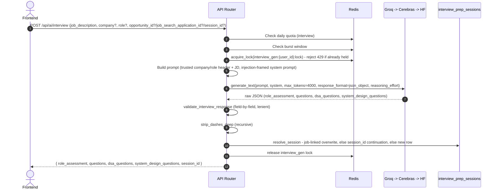
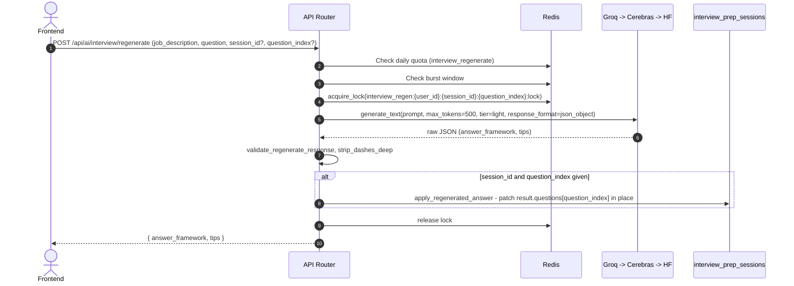

# Interview Prep: Data Flow & Schema Reference

**Document Version:** 1.0.0
**Status:** Approved for Production

---

## 1. Database Schema

### 1.1 `interview_prep_sessions`

One row per saved kit, auto-persisted on generation (see `architecture_lld.md` §2.3) — never an explicit create endpoint. Mirrors `cover_letter_sessions`' shape (`docs/cover_letter/data_flow_and_schema.md` §1.1) but with `company`/`role` **nullable**: a plain pasted JD with no tracked job behind it is a normal, common case for this tool (unlike Cover Letter, where `company`/`role` are always literal, required form fields).

```sql
CREATE TABLE interview_prep_sessions (
    id UUID PRIMARY KEY DEFAULT uuid_generate_v4(),
    created_at TIMESTAMPTZ NOT NULL DEFAULT now(),
    user_id UUID NOT NULL REFERENCES profiles(id) ON DELETE CASCADE,
    job_description TEXT NOT NULL CHECK (char_length(job_description) <= 12000),
    company TEXT CHECK (company IS NULL OR char_length(company) <= 200),
    role TEXT CHECK (role IS NULL OR char_length(role) <= 200),
    result JSONB NOT NULL,
    title TEXT CHECK (title IS NULL OR char_length(title) <= 200),
    source_opportunity_id UUID REFERENCES startup_hunt_opportunities(id) ON DELETE SET NULL,
    source_application_id UUID REFERENCES job_search_applications(id) ON DELETE SET NULL
);
CREATE INDEX interview_prep_sessions_user_id_idx ON interview_prep_sessions(user_id);
```

- `result` holds the full validated generation output (`role_assessment`, `questions`, `dsa_questions`, `system_design_questions`) as JSONB — read-only display data on reopen, never queried into individually by column. A regenerated answer is patched into this JSON blob in place (`service.py::apply_regenerated_answer`), not stored separately.
- No `ai_status`/`ai_provider`/`ai_error` columns — persistence only happens after a successful, already-validated generation (unlike Cover Letter's streaming case, there's no partial/placeholder row to track status on).
- No unique constraint — the "only one saved kit per job" rule (see §3 below) is enforced in application code (`get_by_source`/`session_id` lookup), not a DB constraint, same as Cover Letter.
- `title` — user-renameable via `PATCH /api/ai/interview/sessions/{id}/title`, rename-only (no delete, no re-edit-and-resave), same UX as the other two tools' My Docs.

---

## 2. Redis Keys

### 2.1 Rate Limiting (daily quotas)
- **Generation**: `rl:{user_id}:interview` — `rate_limit_interview_per_day` (default 10).
- **Regeneration**: `rl:{user_id}:interview_regenerate` — `rate_limit_interview_regenerate_per_day` (default 30). Separate from generation because a user might regenerate several individual answers per one generated kit.

### 2.2 Burst Limiting (shared window, both endpoints)
- `rl_burst:{user_id}:interview` / `rl_burst:{user_id}:interview_regenerate`, both using the shared `rate_limit_burst_limit`/`rate_limit_burst_window_seconds` settings.

### 2.3 Single-Flight Locks (concurrency safety, not rate limiting)
- **Generation**: `interview_gen:{user_id}:lock`, TTL 60s, released explicitly in a `finally` the moment the request's own work ends.
- **Regeneration**: `interview_regen:{user_id}:{session_id}:{question_index}:lock`, same TTL/release pattern, scoped per-question rather than per-user so regenerating two different questions in quick succession doesn't block itself.
- See `production_hardening_playbook.md` §1 for why these exist — burst limiting alone doesn't prevent two *concurrent* identical requests from both proceeding.

### 2.4 AI Provider Circuit Breaker (shared, not interview-prep-specific)
- `_CIRCUIT_SCOPE = "ai_llm"` in `app/ai/llm/provider.py` — shared across every tool and every user, same as Cover Letter/Resume Tailor.

---

## 3. Data Flow Diagrams

### 3.1 Generation



### 3.2 Regeneration


