# My Docs: High-Level Architecture (HLD)

**Document Version:** 1.0.0
**Status:** Approved for Production
**Target Audience:** Staff Engineers, Backend Engineers, Frontend Engineers

---

## 1. Executive Overview

**My Docs** (`apps/web/app/(dashboard)/my-docs/page.tsx`) is a single
frontend page that aggregates every document a user has saved across
**three independent backend modules** — it owns no backend module, no
table, and no business logic of its own:

| Document kind | Owning module | Backend prefix |
| :--- | :--- | :--- |
| Resume (tailored) | `resume_tailor` | `/api/ai/tailor/sessions` |
| Cover letter | `cover_letter` | `/api/ai/cover-letter/sessions` |
| Interview kit | `interview_prep` | `/api/ai/interview/sessions` |

Each module independently implements the same conceptual surface — a
list endpoint (My Docs), a detail endpoint (reopen into the tool), and a
rename endpoint — against its own session table
(`tailoring_sessions` / `cover_letter_sessions` / `interview_prep_sessions`).
My Docs' only real logic is **client-side grouping**: three documents
generated for the same tracked job are visually bundled into one card.

### Key Characteristics

1. **No shared backend code between the three modules.** `cover_letter`
   and `interview_prep`'s ownership-verification helpers
   (`verify_opportunity_ownership` etc.) are byte-for-byte duplicates of
   `resume_tailor`'s, kept deliberately separate rather than imported
   cross-module — the same independence convention this codebase uses
   everywhere (each tool owns its own copy rather than depending on
   another tool's internals). See `architecture_lld.md` §3 for the real
   behavioral differences this duplication has allowed to drift in.
2. **Grouping is purely a shared FK, not a join.** All three session
   tables carry the same three nullable linkage columns
   (`source_opportunity_id`, `source_application_id`,
   `source_job_application_id`, all `ON DELETE SET NULL`). My Docs fetches
   all three lists independently and groups client-side on whichever
   column is non-null — there is no backend endpoint that returns
   "this job's documents" as a single query.
3. **Auto-persist, not explicit save, for two of three.** `cover_letter`
   and `interview_prep` save a row on every successful generation via
   their own `resolve_session()` upsert (one row per linked job,
   regardless of how many times it's regenerated). `resume_tailor` is the
   odd one out — its session is the resume *editor's* working document
   (drafts, templates, PDF export all live on it), not a save-on-generate
   row; it predates the other two and the other two were built to mirror
   its session-list/My-Docs shape, not its full lifecycle.
4. **A reopened session locks the tool's form by default.** Reopening a
   saved cover letter or interview kit from My Docs starts that page in a
   read-only view (fields disabled, "Edit & Regenerate" required to
   unlock) — added specifically because both modules' generation
   auto-persists in place, so an accidental resubmit would silently
   overwrite saved content with a fresh, non-deterministic rewrite. See
   §4 and `production_hardening_playbook.md` for why this exists.

---

## 2. System Topology

```mermaid
flowchart TD
    User["Web Client — my-docs/page.tsx<br/>(aggregates 3 lists, groups client-side)"]

    subgraph RT ["resume_tailor — owns the editor lifecycle"]
        RTAPI["FastAPI /api/ai/tailor"]
        RTDB[("tailoring_sessions")]
    end

    subgraph CL ["cover_letter — auto-persist on generate"]
        CLAPI["FastAPI /api/ai/cover-letter"]
        CLDB[("cover_letter_sessions")]
    end

    subgraph IP ["interview_prep — auto-persist on generate"]
        IPAPI["FastAPI /api/ai/interview"]
        IPDB[("interview_prep_sessions")]
    end

    subgraph Link ["Linkage sources (read-only from here)"]
        Opp[("startup_hunt_opportunities")]
        JSApp[("job_search_applications")]
        TrackApp[("job_applications")]
    end

    User -->|list / detail / rename| RTAPI --> RTDB
    User -->|list / detail / rename| CLAPI --> CLDB
    User -->|list / detail / rename| IPAPI --> IPDB

    Opp -.->|source_opportunity_id, SET NULL| RTDB
    Opp -.->|source_opportunity_id, SET NULL| CLDB
    Opp -.->|source_opportunity_id, SET NULL| IPDB
    JSApp -.->|source_application_id, SET NULL| RTDB
    JSApp -.->|source_application_id, SET NULL| CLDB
    JSApp -.->|source_application_id, SET NULL| IPDB
    TrackApp -.->|source_job_application_id, SET NULL| RTDB
    TrackApp -.->|source_job_application_id, SET NULL| CLDB
    TrackApp -.->|source_job_application_id, SET NULL| IPDB

    classDef client fill:#e1f5fe,stroke:#0288d1,stroke-width:2px,color:#01579b;
    classDef owned fill:#e8f5e9,stroke:#388e3c,stroke-width:2px,color:#1b5e20;
    classDef link fill:#fff3e0,stroke:#f57c00,stroke-width:2px,color:#e65100;

    class User client;
    class RTAPI,RTDB,CLAPI,CLDB,IPAPI,IPDB owned;
    class Opp,JSApp,TrackApp link;
```

---

## 3. Key Architectural Patterns

### 3.1 Why Grouping Happens in the Browser, Not the Database

No single query can return "every document for job X" because the three
rows live in three unrelated tables with no FK between them — only a
shared, optional pointer to the *same external row* (an opportunity, a
synced job-search application, or a tracker application). My Docs fetches
all three lists in parallel (`useQuery` × 3), concatenates them into one
`DocRow[]`, and groups by `groupKeyFor()` (whichever of the three source
ids is non-null). A bucket with 2+ rows renders as a `JobGroupCard`; every
other row renders as a plain `DocCard`, unchanged from before grouping
existed. See `architecture_lld.md` §1 for the full frontend shape.

### 3.2 Three Independent `resolve_session` Implementations, Not One

`cover_letter/service.py::resolve_session` and
`interview_prep/service.py::resolve_session` are structurally identical
(resolution order: job-linked existing row → `session_id`-linked ad-hoc
row → create new) but are two separate functions, not a shared one —
each module's docstring explicitly says so. `resume_tailor` has no
`resolve_session` at all; its session-creation logic lives inline in
`routes.py`'s `POST /tailor` handler plus a hash-based cache-hit fast path
(`repository.py::get_or_create_session`) the other two modules don't need,
since a resume+JD pair can be byte-identical across requests in a way a
free-text cover letter/interview-prep generation never is.

### 3.3 The Reopen-Locks-the-Form Pattern

`cover_letter` and `interview_prep`'s generation auto-persists **in
place** — resubmitting Generate on an already-open session updates the
same DB row, not a new one. Reopening a saved session from My Docs
therefore starts the page already holding that session's id in state; if
the form were left live, an accidental re-click of Generate would
silently replace saved content with a fresh, non-deterministic rewrite
(cover letters/interview kits are LLM prose, not deterministic output) and
burn an AI-rate-limit hit for it, with no undo. Both pages now start
locked on reopen (fields disabled, output shown as a view) and require an
explicit "Edit & Regenerate" click to unlock. `resume_tailor` never had
this problem — reopening a resume opens the **editor**, a different page
entirely from the generation form, so there's no "regenerate" button
sitting live on top of saved content to begin with.

---

## 4. Security & Compliance Safeguards

1. **Ownership enforcement**: every list/detail/rename call across all
   three modules is scoped by `user_id` via `UserScopedRepository` — this
   app has no Row Level Security; this is the sole enforcement layer. A
   cross-user session id returns 404, not 403 (the scoped `WHERE` clause
   means the row simply isn't found, not that it's found-and-rejected).
2. **Linkage ids are re-verified server-side before being trusted**: all
   three modules re-check `opportunity_id`/`job_search_application_id`/
   `job_application_id` against the referenced table's own `user_id`
   before writing it as a `source_*_id` FK — a client can't link a
   generation to a job it doesn't own, even if it guesses a valid id.
3. **At-most-one-saved-document-per-job is a real DB constraint, not
   just app logic**: partial unique indexes on
   `(user_id, source_opportunity_id)` / `(user_id, source_application_id)`
   / `(user_id, source_job_application_id)`, added after this audit found
   the per-user Redis single-flight generation lock was the *only*
   protection against two concurrent requests for the same job creating
   duplicate rows — and that lock fails open if Redis is unreachable. See
   `production_hardening_playbook.md` §2.
4. **Rate limiting on every endpoint, including reads**: list and rename
   were already burst-limited in all three modules; the single-session
   detail/reopen `GET` had none until this audit — now burst-limited
   consistently across all three. See `production_hardening_playbook.md`
   §1.
5. **Input length caps at both layers**: every text column has a Pydantic
   `max_length` and a matching DB `CheckConstraint` — `cover_letter_
   sessions.resume_text` was the one exception (schema-only) until this
   audit; see `production_hardening_playbook.md` §3.
