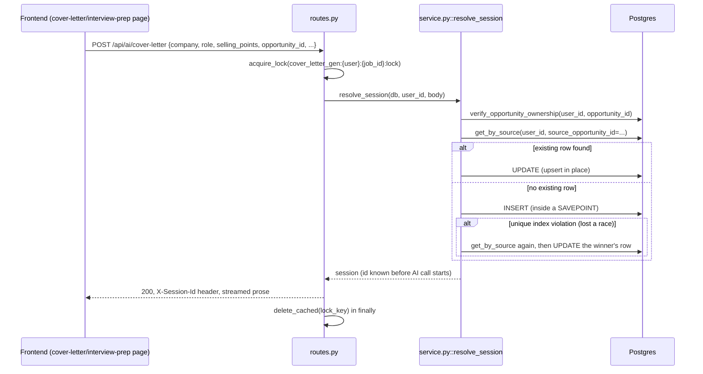
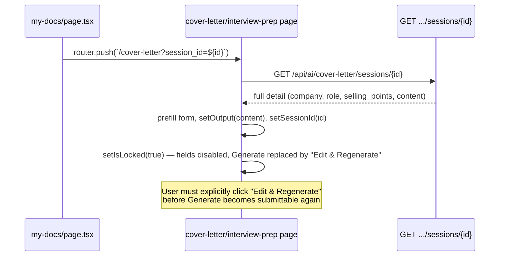

# My Docs: Data Flow & Schema

**Document Version:** 1.0.0
**Status:** Approved for Production

---

## 1. Tables

Three tables, one per document kind, all `Base, UUIDPKMixin, CreatedAtMixin`
(`id`, `created_at` free). None has RLS — `UserScopedRepository` is the
sole enforcement layer (see `app/shared/repository.py`).

### 1.1 `tailoring_sessions` (resume_tailor)
The richest of the three — also holds the resume editor's working state
(draft, template, chunking/embedding cache), not just a "saved document."
Key columns beyond the common linkage set: `resume_version_id`,
`job_hash`, `job_text`, `job_chunks`/`job_embeddings` (JSONB),
`analysis` (deterministic `MatchResult.as_dict()`), `prose` (AI-generated,
nullable when `ai_status='degraded'`), `draft_cv_data`/`draft_version`,
`template_id`, `ai_status`.

### 1.2 `cover_letter_sessions` (cover_letter)
```
user_id             UUID  FK profiles.id, CASCADE
company             text  NOT NULL, <= 200
role                text  NOT NULL, <= 200
selling_points       text  NOT NULL, <= 3000
resume_text          text  NULL, <= 8000   -- DB check added in this audit
content              text  NOT NULL, <= 5000
title                text  NULL, <= 200
source_opportunity_id     UUID  NULL, FK startup_hunt_opportunities.id, SET NULL
source_application_id     UUID  NULL, FK job_search_applications.id, SET NULL
source_job_application_id UUID  NULL, FK job_applications.id, SET NULL
```

### 1.3 `interview_prep_sessions` (interview_prep)
```
user_id             UUID  FK profiles.id, CASCADE
job_description      text  NOT NULL, <= 12000
company              text  NULL, <= 200   -- nullable: a plain pasted JD often has no known company
role                 text  NULL, <= 200
result               JSONB NOT NULL        -- role_assessment + questions + dsa_questions + system_design_questions
title                text  NULL, <= 200
source_opportunity_id     UUID  NULL, FK startup_hunt_opportunities.id, SET NULL
source_application_id     UUID  NULL, FK job_search_applications.id, SET NULL
source_job_application_id UUID  NULL, FK job_applications.id, SET NULL
```

---

## 2. Linkage Columns — Shared Shape, Independent Tables

All three tables carry the same three nullable FKs, added across two
migrations each:

| Column | References | On delete | Added |
| :--- | :--- | :--- | :--- |
| `source_opportunity_id` | `startup_hunt_opportunities.id` | `SET NULL` | original table migration |
| `source_application_id` | `job_search_applications.id` | `SET NULL` | original table migration |
| `source_job_application_id` | `job_applications.id` | `SET NULL` | `c2e5f9b7a814` (all 3 tables, one migration) |

`resolve_session()` (cover_letter/interview_prep) and the equivalent
inline logic in resume_tailor's `routes.py` set **at most one** of the
three on any given row — they're mutually exclusive by construction
(checked in priority order: opportunity → job-search application →
tracker application), never validated as mutually exclusive at the DB
layer (nothing stops a future code path from setting two; none does
today).

**`ON DELETE SET NULL`, not `CASCADE`, by deliberate design**: deleting
the opportunity/application/tracker-row a document was generated for
should not delete the document itself — "a resume analysis is still
worth keeping if the user later deletes the application it was built
for" (verbatim from all three modules' model comments). My Docs' display
falls back gracefully once the FK is nulled (resume_tailor's
`display_label` falls through to its AI-parsed-prose or generic tier;
cover_letter/interview_prep already have the linked job's company/role
captured as plain literal columns on the row itself, so nulling the FK
loses only the grouping, never the displayed label).

### 2.1 Race-Condition Backstop (added in this audit)

Partial unique indexes — one per linkage column, per table (6 total),
`WHERE <column> IS NOT NULL`:

```sql
CREATE UNIQUE INDEX cover_letter_sessions_user_opportunity_key
  ON cover_letter_sessions (user_id, source_opportunity_id)
  WHERE source_opportunity_id IS NOT NULL;
-- + source_application_id, source_job_application_id, same table
-- + all three again for interview_prep_sessions
```

A plain table-level `UNIQUE(user_id, source_opportunity_id)` constraint
would be wrong here — the column is optional, and Postgres only exempts
`NULL <> NULL` from a *constraint's* rejection in a way that still
collapses all-NULL rows together in some contexts; a **partial** index
makes "uniqueness applies only when this column is actually set"
explicit, the same pattern already used for `company_registry`'s
`domain`/`discovery_source_id` dedup keys (`startup_hunt/models.py`).
Verified via a read-only query against the live DB before writing the
migration — zero existing duplicate `(user_id, source_*_id)` pairs across
both tables, so the migration applies cleanly with no pre-existing data
to reconcile.

Migration: `f6a9c2e5b831_harden_cover_letter_and_interview_sessions.py`
(chains after `c2e5f9b7a814`, the current head at time of writing). **Not
yet applied to the live database** — run `uv run alembic upgrade head`
from `apps/api` to apply it; `uv run alembic upgrade head --sql` was used
to validate the generated SQL without touching the DB.

---

## 3. End-to-End Flow: Generating a Linked Document



## 4. Reopening a Document from My Docs


