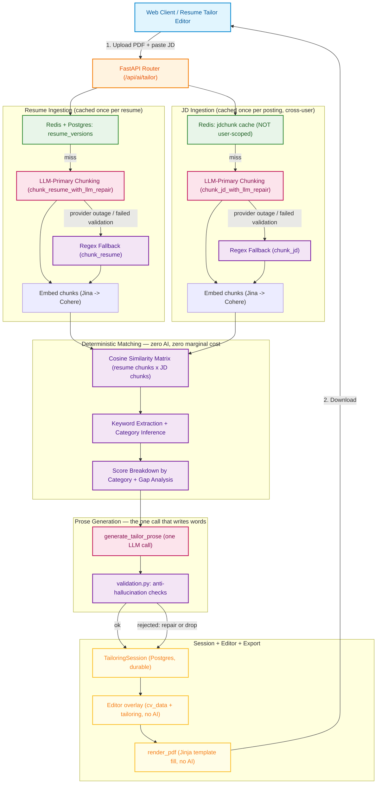

# Resume Tailor: High-Level Architecture (HLD)

**Document Version:** 1.0.0
**Status:** Approved for Production
**Target Audience:** Staff Engineers, Systems Architects, Backend Engineers

---

## 1. Executive Overview

**Resume Tailor** takes a candidate's resume and a job description and produces a tailored, ATS-scored, downloadable resume. Its defining architectural decision is a strict split between two concerns that are usually conflated into a single LLM prompt elsewhere: **deciding whether something matches** (deterministic, zero-AI, cosine similarity + keyword overlap) and **writing prose about it** (one focused LLM call, constrained to only describe matches that already exist). The deterministic layer is the ground truth the LLM's output is checked against — not the other way around.

### Key Architectural Objectives
1. **Reproducible, Explainable Scoring**: `match_score` is a pure function of (resume, JD) content — same inputs always produce the same score, and every point of it traces back to a specific cosine-similarity comparison or keyword-overlap ratio, not an LLM's unaudited judgment.
2. **Anti-Hallucination by Construction**: the LLM is never asked to invent whether a requirement is met — only to write about matches/gaps a separate deterministic pass already computed, then independently validated against the raw resume text before being trusted (`validation.py`).
3. **LLM-Primary Structuring, Deterministic Fallback**: both JD and resume text are chunked into typed units (bullet/skill/requirement/etc.) by an LLM call first, with a regex chunker as the fallback for provider outages or failed output validation — never a hard failure.
4. **Aggressive, Correctly-Scoped Caching**: a resume is parsed once per (user, PDF hash) and reused across every future JD tailored against it; a JD's chunking/embedding result is cached once per (cleaned JD hash) and shared **across users** targeting the same posting — not scoped per-user, since JD classification reveals nothing user-specific.

---

## 2. System Topology & Architecture Diagram

---

## 3. High-Level Component Responsibilities

| Component | Module Location | Responsibility |
| :--- | :--- | :--- |
| **API Router** | `routes.py` | HTTP endpoints, session lifecycle, resume ingestion orchestration, single-flight locking. |
| **Chunker (regex)** | `chunker.py` | Pure-regex/heuristic JD and resume segmentation — the deterministic fallback for both LLM-primary chunking paths, plus `clean_jd_text` and the `*_chunking_is_pathological` quality gates. |
| **Matcher** | `matcher.py` | The deterministic heart: keyword extraction, cosine-similarity matching, score breakdown, gap analysis, rewrite-candidate selection — zero AI. |
| **Generation** | `generation.py` | Every LLM call in the module: JD/resume LLM-primary chunking, base CV structuring, tailoring prose, JD translation. |
| **Prompts** | `prompts.py` | All prompt text and version constants (`MATCHER_VERSION`, `*_PROMPT_VERSION`) — versioning drives cache invalidation. |
| **Validation** | `validation.py` | Deterministic anti-hallucination checks on every piece of LLM output — bullet rewrites, summaries, headline skills, and the LLM chunking paths' verbatim/coverage checks. |
| **Cache** | `cache.py` | Redis read-through layer: resume blob cache (user-scoped), JD chunk cache (NOT user-scoped — shared across applicants), prose cache, single-flight locks. |
| **Repository** | `repository.py` | Postgres access for `resume_versions`, `tailoring_sessions`, `saved_resumes` — all via `UserScopedRepository`. |
| **Rendering** | `rendering.py` | Deterministic Jinja template fill + WeasyPrint PDF export — no AI, no cost. |
| **Schemas** | `schemas.py` | Pydantic request/response models and `CvDataSchema` (validates the LLM's base-structuring output at the boundary). |

---

## 4. Key Architectural Patterns & Guarantees

### 4.1 Deterministic Matching, LLM Prose — Never Merged
Matching/scoring and prose generation are two separate calls by design, not an implementation convenience. The matcher produces `RequirementMatch` objects with a specific `best_evidence` quote per requirement; the prose prompt receives this as read-only context ("DETERMINISTIC ANALYSIS (do not recompute, just use)") and is validated afterward against the raw resume text, not against its own prior output. This is what makes the anti-hallucination checks possible at all — see `docs/resume_tailor/production_hardening_playbook.md` and this module's own hard-won regex/LLM-chunking bug history for why a single merged call was rejected.

### 4.2 LLM-Primary Chunking, Regex as Safety Net, Not the Other Way Around
Both JD and resume chunking run through an LLM call first (`chunk_jd_with_llm_repair`, `chunk_resume_with_llm_repair`), validated by a verbatim-substring + coverage check (`validate_llm_jd_chunks`, `validate_llm_resume_chunks`) before being trusted. The regex chunker (`chunk_jd`, `chunk_resume`) is the fallback for provider exhaustion, malformed JSON, or failed validation — never raises, always returns something usable. `*_chunking_is_pathological` flags the rare case where even the fallback looks structurally broken, surfacing `degraded: true` to the UI instead of a silently wrong score.

### 4.3 Asymmetric, Correctly-Scoped Caching
A resume is parsed/chunked/embedded exactly once per (user, PDF hash) — persisted durably in Postgres, Redis-accelerated, 30-day TTL — because the same resume gets tailored against many different JDs. A JD is **never** reused by the same mechanism (every posting is unique text), but its chunking/embedding result is cached by a hash of the *cleaned* text (not the raw submission, which varies between users/sessions due to per-session tracker metadata and copy-paste formatting differences) with a 7-day TTL, **not scoped by user** — two different applicants targeting the same posting share one LLM call instead of each paying for their own.

### 4.4 Version-Gated Cache Invalidation
`MATCHER_VERSION`, `PROSE_PROMPT_VERSION`, `JD_CHUNK_PROMPT_VERSION`, `RESUME_CHUNK_PROMPT_VERSION`, and `STRUCT_PROMPT_VERSION` are independent version strings baked into every cache key and the `TailoringSession`/`ResumeVersion` rows. A logic or prompt change bumps its constant, which naturally busts every cache keyed on it — no manual cache flush, no stale-analysis bugs surviving a deploy.

---

## 5. Security & Compliance Safeguards

1. **Ownership enforcement via `UserScopedRepository`**: every `resume_versions`/`tailoring_sessions`/`saved_resumes` query is scoped by `user_id` in code — the app connects with an RLS-bypassing Postgres role, so this is the actual enforcement layer, not a backstop.
2. **Rate limiting fails closed on the expensive path**: `resume_tailor_ai` (AI generation) is a hard daily quota; Redis-down fails open only for cheap reads, per the codebase-wide philosophy.
3. **No secrets/PII in logs**: resume text, JD text, and JWTs are never logged — only hashes, counts, and status flags.
4. **Input length caps**: JD text, resume PDF size, and title fields all have explicit max lengths validated at the Pydantic boundary.
5. **Saved resumes never expose a direct file URL**: Cloudinary's `authenticated` delivery mode + server-side signed-URL re-derivation on every read — the frontend never receives a bare link to a candidate's resume PDF.
