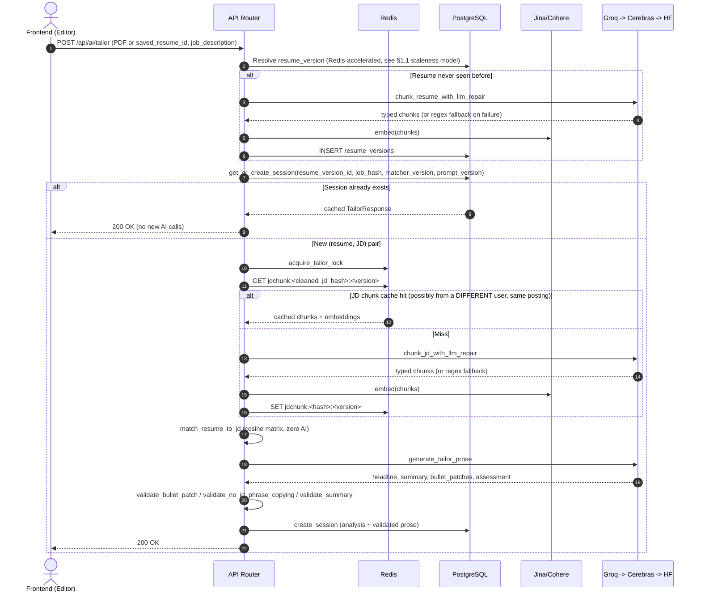

# Resume Tailor: Data Flow & Schema Reference

**Document Version:** 1.0.0
**Status:** Approved for Production

---

## 1. Database Schemas (PostgreSQL)

### 1.1 `resume_versions` Table (Per-user, Content-Addressed)

One row per distinct uploaded resume PDF, keyed by content hash — chunked and embedded exactly once, reused across every JD it's later tailored against.

```sql
CREATE TABLE resume_versions (
    id UUID PRIMARY KEY DEFAULT gen_random_uuid(),
    user_id UUID NOT NULL REFERENCES profiles(id) ON DELETE CASCADE,
    sha256 TEXT NOT NULL,                          -- content hash of the raw PDF bytes
    raw_text TEXT NOT NULL,                        -- extracted via PyMuPDF
    chunks JSONB NOT NULL DEFAULT '[]',             -- [{kind, section, text}, ...]
    chunks_version TEXT,                            -- RESUME_CHUNK_PROMPT_VERSION that produced `chunks`; NULL = pre-LLM-chunking row
    embeddings JSONB NOT NULL DEFAULT '[]',          -- one vector per chunk, same order
    embeddings_model TEXT,                           -- e.g. "jina-embeddings-v3"
    base_cv_data JSONB,                              -- NULL until first editor visit (lazy structuring)
    base_cv_data_prompt_version TEXT,
    last_used_at TIMESTAMPTZ NOT NULL DEFAULT NOW(),
    created_at TIMESTAMPTZ NOT NULL DEFAULT NOW(),

    CONSTRAINT resume_versions_user_id_sha256_key UNIQUE (user_id, sha256)
);
```

**Staleness model**: `chunks_version`/`embeddings_model` are checked on every read (`routes.py::_resolve_resume_version`) against the current `RESUME_CHUNK_PROMPT_VERSION`/active embeddings model — a mismatch triggers a one-time re-chunk/re-embed, persisted back. Re-chunking always forces re-embedding too, since embeddings are position-aligned to `chunks`.

---

### 1.2 `tailoring_sessions` Table (Per-user, Durable Result)

```sql
CREATE TABLE tailoring_sessions (
    id UUID PRIMARY KEY DEFAULT gen_random_uuid(),
    user_id UUID NOT NULL REFERENCES profiles(id) ON DELETE CASCADE,
    resume_version_id UUID NOT NULL REFERENCES resume_versions(id) ON DELETE CASCADE,
    job_hash TEXT NOT NULL,                          -- sha256 of the RAW submitted JD text
    job_text TEXT NOT NULL,                           -- CHECK char_length <= 20000
    job_text_clean TEXT NOT NULL,
    job_chunks JSONB NOT NULL DEFAULT '[]',
    job_embeddings JSONB NOT NULL DEFAULT '[]',
    analysis JSONB NOT NULL DEFAULT '{}',              -- MatchResult.as_dict() — deterministic, never LLM-touched
    prose JSONB,                                        -- NULL when ai_status='degraded'
    matcher_version TEXT NOT NULL,
    prompt_version TEXT NOT NULL,
    status TEXT NOT NULL DEFAULT 'ready',               -- CHECK IN ('ready', 'failed')
    ai_status TEXT NOT NULL DEFAULT 'ok',                -- CHECK IN ('ok', 'degraded')
    ai_provider TEXT,
    ai_error TEXT,
    template_id TEXT,
    title TEXT,                                          -- CHECK char_length <= 200
    draft_cv_data JSONB,                                  -- autosaved in-progress editor edits
    draft_version INT NOT NULL DEFAULT 0,                 -- optimistic-concurrency counter
    source_opportunity_id UUID REFERENCES startup_hunt_opportunities(id) ON DELETE SET NULL,
    source_application_id UUID REFERENCES job_search_applications(id) ON DELETE SET NULL,
    saved_resume_id UUID REFERENCES saved_resumes(id) ON DELETE SET NULL,
    created_at TIMESTAMPTZ NOT NULL DEFAULT NOW()
);

CREATE INDEX tailoring_sessions_user_resume_job_idx
    ON tailoring_sessions (user_id, resume_version_id, job_hash);
```

**Session dedup**: `get_or_create_session(user_id, resume_version_id, job_hash, matcher_version, prompt_version)` reuses an existing row whenever all five match — a retry, page refresh, or re-open costs nothing. `force_refresh=true` bypasses this lookup entirely.

**Draft concurrency**: `PATCH /tailor/{id}/draft` takes `base_version` from the client and rejects (`409`) if it doesn't match the row's current `draft_version` — two tabs editing the same session get a conflict signal instead of silent last-write-wins.

---

### 1.3 `saved_resumes` Table ("My Resumes", up to 3/user)

```sql
CREATE TABLE saved_resumes (
    id UUID PRIMARY KEY DEFAULT gen_random_uuid(),
    user_id UUID NOT NULL REFERENCES profiles(id) ON DELETE CASCADE,
    slot INT NOT NULL,                                -- CHECK slot BETWEEN 1 AND 3
    label TEXT NOT NULL,                              -- CHECK char_length <= 100
    cloudinary_public_id TEXT NOT NULL,                -- never a URL — re-signed server-side on every read
    original_filename TEXT NOT NULL,
    sha256 TEXT NOT NULL,
    updated_at TIMESTAMPTZ NOT NULL DEFAULT NOW(),
    created_at TIMESTAMPTZ NOT NULL DEFAULT NOW(),

    CONSTRAINT saved_resumes_user_id_slot_key UNIQUE (user_id, slot)
);
```

Stored in Cloudinary with `resource_type="raw", type="authenticated"` — stricter than the profile photo's public delivery mode, since a resume carries far more PII per asset. Every consumer (list/preview/download/compare-with-original) goes through an authenticated backend endpoint; the frontend never receives a bare Cloudinary link.

---

## 2. Redis Caching Topology

### 2.1 Resume Blob Cache (user-scoped)
- **Key Schema**: `resume:{user_id}:{sha256}`
- **Payload**: `{text, chunks, chunks_version, embeddings, embeddings_model, base_cv_data?, base_cv_data_prompt_version?}`
- **TTL**: 30 days — resumes change rarely.
- Scoped per `user_id` specifically to prevent cross-user cache-timing inference (knowing whether another user uploaded the same resume).

### 2.2 JD Chunk Cache (NOT user-scoped — deliberately shared)
- **Key Schema**: `jdchunk:{sha256_of_cleaned_jd_text}:{JD_CHUNK_PROMPT_VERSION}`
- **Payload**: `{chunks, degraded, embeddings, embeddings_model}`
- **TTL**: 7 days — postings get edited/pulled far more often than a resume changes.
- Hashed on `clean_jd_text()` output, not the raw submission — raw text varies between users/sessions (different copy-paste source formatting, plus per-session tracker metadata the job-tracker UI appends and `clean_jd_text` strips). Hashing the cleaned form is what actually lets two different applicants targeting the same posting share one cached result.

### 2.3 Prose Cache (user-scoped)
- **Key Schema**: `prose:{user_id}:{resume_hash}:{job_hash}:{prompt_version}:{model}`
- **TTL**: 7 days normal, 120 seconds if `ai_status=degraded` (absorbs a burst of retries without re-hammering an exhausted provider chain, while letting a genuine recovery surface within ~2 minutes).

### 2.4 Single-Flight Locks
- **Tailor lock**: `tailor:{user_id}:{resume_hash}:{job_hash}:{normal|force}:lock` — wraps JD translation through session creation (an embeddings API call is real money; two concurrent identical submissions must not both pay for it).
- **Prose lock**: `prose:{user_id}:{resume_hash}:{job_hash}:{prompt_version}:lock` — narrower, just the LLM prose call.

---

## 3. Data Flow Diagram


