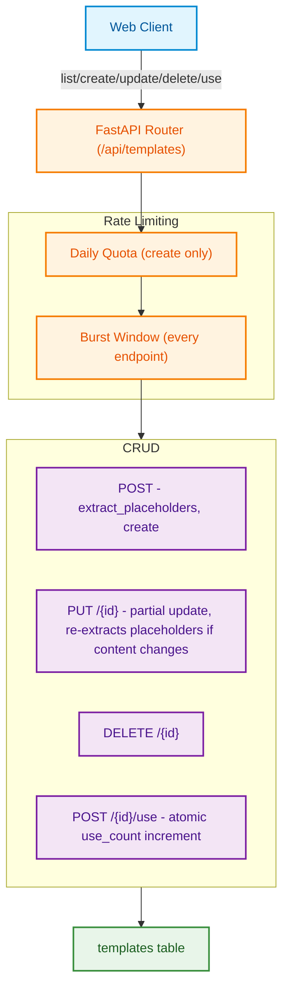

# Smart Templates: High-Level Architecture (HLD)

**Document Version:** 1.0.0
**Status:** Approved for Production
**Target Audience:** Staff Engineers, Backend Engineers

---

## 1. Executive Overview

**Smart Templates** is a plain CRUD tool, deliberately the simplest in this codebase: users save reusable outreach messages (`{{placeholder}}`-style), fill them in client-side, and copy the result. There is no AI generation, no scraping, no external API call anywhere in this tool — every other tool's hardening concerns (circuit breakers, AI provider fallback, embeddings) simply don't apply here. A fixed set of prebuilt templates (`apps/web/lib/templates/prebuilt.ts`) ships alongside the user's own saved ones and is never persisted server-side.

### Key Characteristics
1. **No AI, no external calls**: placeholder extraction (`{{name}}` → `name`) is a pure regex, run both client-side (`@jobnok/ui`'s `extractPlaceholders`, for the live "detected placeholders" preview while typing) and server-side (`service.py::extract_placeholders`, to persist the authoritative list) — not duplicated for AI-cost reasons, there simply is no AI call to parallel the resume_tailor/cover_letter pattern of "deterministic client preview, authoritative server computation."
2. **Still rate limited and bounded, despite no AI cost**: CLAUDE.md's rate-limiting and input-length rules don't carve out an exception for non-AI tools, and this tool previously had neither (see `production_hardening_playbook.md`) — a storage-abuse/spam vector even without a paid provider in the loop.
3. **Client-trusted fields need server-side re-validation too**: `category` is a fixed enum on the frontend's Zod schema, but the backend previously accepted any string — Zod alone doesn't protect the database from a non-browser client.

---

## 2. System Topology

---

## 3. Key Architectural Patterns

### 3.1 Atomic `use_count`, Not Client-Computed
`POST /{id}/use` issues a single `UPDATE templates SET use_count = use_count + 1 ... RETURNING *` at the DB layer, rather than the frontend reading the current count and PUTting `current + 1`. The latter is a real race: two rapid copies, or two browser tabs, can both read the same stale count and both write the same incremented value, silently losing one. `use_count` was removed from the generic `PUT /{id}` update schema entirely — it can only change through this one atomic path.

### 3.2 Category Is a Shared Enum, Not a Free String
`TemplateCategory` is now a Pydantic `Literal` mirroring the frontend's Zod enum (`apps/web/lib/types.ts::TEMPLATE_CATEGORIES`) field-for-field, enforced again at the DB layer via a `CheckConstraint` — the same "Zod + Pydantic + DB constraint" three-layer pattern this codebase uses everywhere else, just applied here for the first time. Previously the backend accepted any string.

### 3.3 Prebuilt Templates Never Touch the Database
`PREBUILT_TEMPLATES` is a static frontend array, merged with the user's own saved templates client-side (`[...savedTemplates, ...PREBUILT_TEMPLATES]`) and distinguished by `is_prebuilt: true`. The backend has no concept of them at all — `GET /api/templates` only ever returns user-owned rows. Delete/rename actions are hidden in the UI for prebuilt entries since there's nothing server-side to act on.

---

## 4. Security & Compliance Safeguards

1. **Input length caps**: `name` (100 chars), `content` (5,000 chars) — both previously unbounded at every layer (Pydantic and the DB column), a DoS vector per CLAUDE.md's input-length rule.
2. **Category enum enforcement**: Pydantic `Literal` + DB `CheckConstraint`, matching the frontend's Zod enum.
3. **Rate limiting**: a daily quota on creation (storage-abuse ceiling, not AI-cost related) plus a burst window on every endpoint, including the list/read.
4. **Ownership enforcement**: every query scoped by `user_id` via `UserScopedRepository`, same enforcement mechanism as every other tool — this app has no RLS to fall back on.
5. **No secrets/PII in logs**: this module has no logging at all (nothing to log — no AI calls, no external requests).
