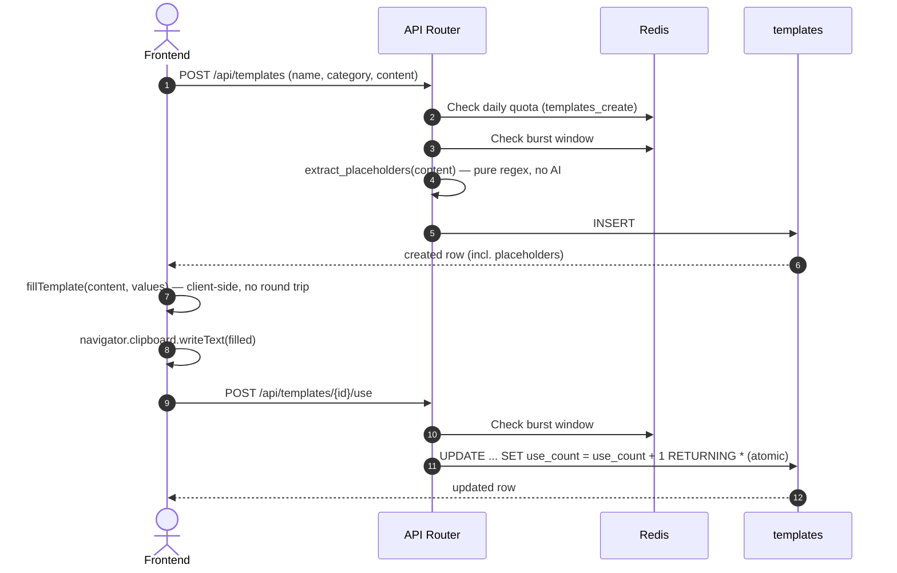

# Smart Templates: Data Flow & Schema Reference

**Document Version:** 1.0.0
**Status:** Approved for Production

---

## 1. Database Schema

### 1.1 `templates`

```sql
CREATE TABLE templates (
    id UUID PRIMARY KEY DEFAULT uuid_generate_v4(),
    created_at TIMESTAMPTZ NOT NULL DEFAULT now(),
    user_id UUID NOT NULL REFERENCES profiles(id) ON DELETE CASCADE,
    name TEXT NOT NULL CHECK (char_length(name) <= 100),
    category TEXT NOT NULL DEFAULT 'Custom'
        CHECK (category IN ('Cold DM - Recruiter', 'Cold DM - Hiring Manager', 'Follow-Up', 'Referral Ask', 'Email Outreach', 'Custom')),
    content TEXT NOT NULL CHECK (char_length(content) <= 5000),
    placeholders TEXT[] NOT NULL DEFAULT '{}',
    use_count INTEGER NOT NULL DEFAULT 0
);
CREATE INDEX templates_user_id_idx ON templates(user_id);
CREATE INDEX templates_category_idx ON templates(category);
```

- `placeholders` is derived, never client-supplied — always recomputed server-side from `content` via `extract_placeholders` on create and on any update that touches `content`.
- `use_count` only ever changes through `POST /{id}/use`'s atomic increment (see `architecture_lld.md` §2.3/§3.1) — never through a direct value in the generic `PUT /{id}` update.
- The three `CheckConstraint`s (`templates_name_length_check`, `templates_content_length_check`, `templates_category_check`) were added in migration `f4b8d1c9e3a7`, after confirming via a direct query that no existing row violated any of them (the table was empty at the time).

---

## 2. Redis Keys

### 2.1 Rate Limiting (daily quota)
- **Creation only**: `rl:{user_id}:templates_create` — `rate_limit_templates_create_per_day` (default 50). A generous storage-abuse ceiling, not an AI-cost quota — this is the only tool in this codebase with a daily quota that has nothing to do with a paid provider call.

### 2.2 Burst Limiting (every endpoint)
- `rl_burst:{user_id}:templates_list` / `templates_create` / `templates_update` / `templates_delete` / `templates_use` — all using the shared `rate_limit_burst_limit`/`rate_limit_burst_window_seconds` settings. Unlike most other tools (which only burst-limit writes or AI calls), the plain list/read endpoint is burst-limited here too, matching the "every endpoint, not just the obviously-expensive ones" principle from `docs/resume_tailor/production_hardening_playbook.md`'s own checklist.

---

## 3. Data Flow Diagram


