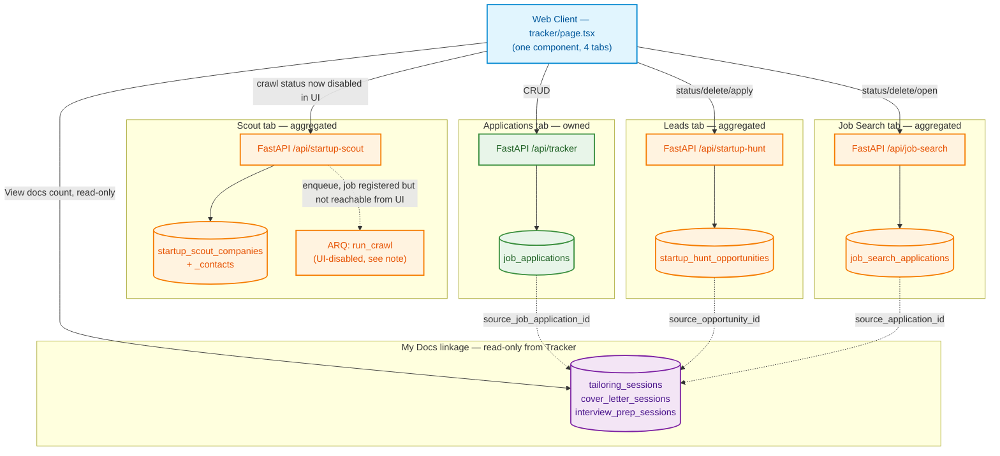

# Tracker: High-Level Architecture (HLD)

**Document Version:** 1.0.0
**Status:** Approved for Production
**Target Audience:** Staff Engineers, Backend Engineers, Frontend Engineers

---

## 1. Executive Overview

**Tracker** is the one surface in this app where a user manages every job
they're pursuing, regardless of which tool found it. It is **not** a
single CRUD module — it's a dashboard that owns one table outright
(`job_applications`, the "Applications" tab) and **reads, but does not
own**, three other modules' data for its other three tabs:

| Tab | Data owned by | Backend prefix |
| :--- | :--- | :--- |
| Applications | Tracker itself | `/api/tracker` |
| Leads | `startup_hunt` | `/api/startup-hunt` |
| Scout | `startup_scout` | `/api/startup-scout` |
| Job Search | `job_search` | `/api/job-search` |

This matters architecturally: Tracker's frontend (`apps/web/app/(dashboard)/
tracker/page.tsx`, ~2,100 lines, by far the largest page in this app) is a
single React component that fetches from four independent backend modules,
each with its own status enum, its own mutation endpoints, and its own
rate-limit identity — Tracker adds no new backend logic for three of its
four tabs, only a unified presentation layer over them.

### Key Characteristics

1. **Aggregator, not owner, for 3 of 4 tabs.** A status change, a delete, a
   crawl trigger on the Leads/Scout/Job Search tabs calls straight through
   to that tab's real owning module's endpoints (`startup_hunt`,
   `startup_scout`, `job_search` respectively) — Tracker's own backend
   (`app/modules/tracker/`) only ever touches `job_applications`.
2. **Cross-module document linkage, not ownership.** Resume Tailor, Cover
   Letter, and Interview Prep sessions can optionally carry a
   `source_job_application_id` (alongside the pre-existing
   `source_opportunity_id`/`source_application_id` for Leads/Job-Search)
   — a nullable FK recording "this document was generated for this
   tracked job," letting My Docs group a resume + cover letter + interview
   kit together, and letting Tracker show a "View docs →" link back. See
   §2's diagram and `data_flow_and_schema.md` §1.2.
3. **Mobile gets a second, parallel render path, not a squeezed table.**
   Below the `sm` breakpoint, every tab renders compact cards instead of
   the desktop `<Table>` — both layouts are always mounted, CSS
   (`hidden sm:block` / `sm:hidden`) picks which one shows. See
   `architecture_lld.md` §2.4.
4. **Cursor pagination, opt-in per endpoint.** All four list endpoints
   (`/api/tracker`, `/api/startup-hunt/opportunities`,
   `/api/startup-scout/companies`, `/api/job-search/applications`) accept
   an optional `limit`/`cursor` pair; omitting both preserves the original
   unbounded response, so every other consumer of these same endpoints
   (Dashboard, Startup Hunt's own page, Startup Scout's own page, Recent
   Job Search) is unaffected. See §3.2.

---

## 2. System Topology

---

## 3. Key Architectural Patterns

### 3.1 Why Three Tabs Have No Tracker-Specific Backend Code

Leads/Scout/Job Search already existed as full tools (Startup Hunt, Startup
Scout, Recent Job Search) before Tracker surfaced them as tabs. Tracker
reuses their existing endpoints verbatim rather than mirroring their data
into a Tracker-owned table — a status update on the Leads tab is a plain
`PUT` to `startup_hunt`'s own endpoint, not a Tracker endpoint that
forwards the call. This avoids a second source of truth (and the
sync-drift bugs that come with one) at the cost of Tracker's frontend
needing to speak four slightly different status-enum/field-naming
vocabularies in one file.

### 3.2 Cursor Pagination, Not Offset — and Why It Had to Be Opt-In

Every list endpoint above previously returned its *entire* table in one
response — fine at today's scale, not something that stays fine as a
single user's job search runs for months without ever deleting old rows
(the premise that motivated this work: nobody deletes a tracked
application once it's rejected).

Keyset (cursor) pagination was chosen over `OFFSET` specifically because
offset pagination has a correctness bug under concurrent writes: if a user
adds a new row while paging through page 2, every row below it shifts by
one, so `OFFSET 50` no longer points at the same logical row — rows get
skipped or duplicated. A cursor anchored to `(created_at, id)` doesn't have
this problem; it's a value comparison, not a position.

It had to be **opt-in** (`limit`/`cursor` both optional, full unbounded
response when neither is passed) because these four endpoints are shared
with pages Tracker doesn't own: Dashboard's stat widgets, Startup Hunt's
own page, Startup Scout's own page, and Recent Job Search all call the
same URLs expecting the complete list. Changing the default response shape
would have broken all four silently. See `shared/repository.py::list_page`
for the implementation and `production_hardening_playbook.md` §2 for how
this was verified not to affect those other callers.

### 3.3 Cross-Module Document Grouping via a Third Linkage Column

My Docs already grouped a resume + cover letter generated for the same
**Startup Hunt lead** or the same **synced Job Search row** (via
`source_opportunity_id`/`source_application_id` on each session table).
A manually-added Tracker **Application** row had no such column at all —
documents generated from it could never be grouped or found. The fix
added a third, parallel nullable FK (`source_job_application_id` →
`job_applications.id`, `ON DELETE SET NULL`) to all three session tables,
with the same ownership-verification pattern (`verify_job_application_
ownership`) the other two linkages already used. See
`data_flow_and_schema.md` §1.2 and §3 for the full flow.

### 3.4 Mobile Is a Parallel Render Path, Not a Breakpoint Hack on the Table

A `<table>` element fundamentally doesn't fit a phone screen — either
every column shrinks/wraps illegibly, or the whole row scrolls
horizontally out of view. Rather than trying to make the existing
`<Table>` cope, every tab has a second render function
(`renderApplicationCard`, `renderLeadCard`, `renderScoutCard`,
`renderJobSearchCard`) producing a compact card, reusing the exact same
state/handlers as the desktop table. Both layouts are always in the DOM;
`hidden sm:block` / `sm:hidden` toggles which one is visible — the same
dual-render convention this page already used for its stat cards before
this work, kept consistent rather than introducing a `window.matchMedia`
check (which would add hydration-mismatch risk for no measurable benefit
at this page's actual row counts).

---

## 4. Security & Compliance Safeguards

1. **Ownership enforcement**: every query across all four tabs' backends
   is scoped by `user_id` via `UserScopedRepository` (Tracker's own table)
   or the owning module's equivalent — this app has no Row Level Security
   to fall back on; this is the enforcement layer.
2. **Cursor pagination can't leak across users**: the `user_id` scope is
   applied to the base query *before* the cursor's `WHERE` clause is
   added (`shared/repository.py::list_page`) — a tampered or foreign
   cursor value is just a comparison point, never a lookup that could
   return another user's row.
3. **Input length caps + status enums**: `company`/`role` (200 chars),
   `notes` (3,000 chars), `status` restricted to a fixed `Literal` —
   enforced at Zod (frontend), Pydantic (backend), and a DB
   `CheckConstraint` (defense in depth), matching this codebase's
   three-layer convention everywhere else.
4. **Rate limiting**: every Tracker-owned endpoint (including the list
   read) has a burst-window check; `POST` additionally has a daily quota
   — a storage-abuse ceiling, not AI-cost related, since this tab has no
   AI or scraping of its own.
5. **No secrets/PII in logs**: Tracker's own backend logs nothing;
   cross-module calls inherit each owning module's own logging
   discipline (documented in their respective hardening playbooks).
