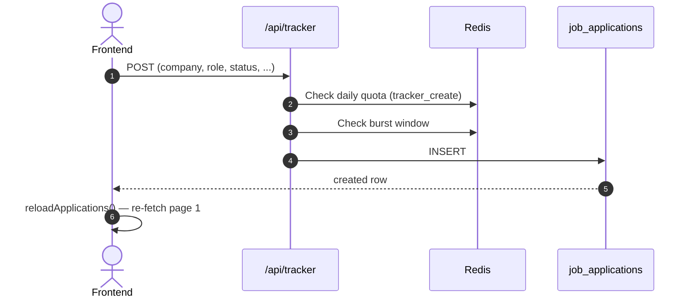
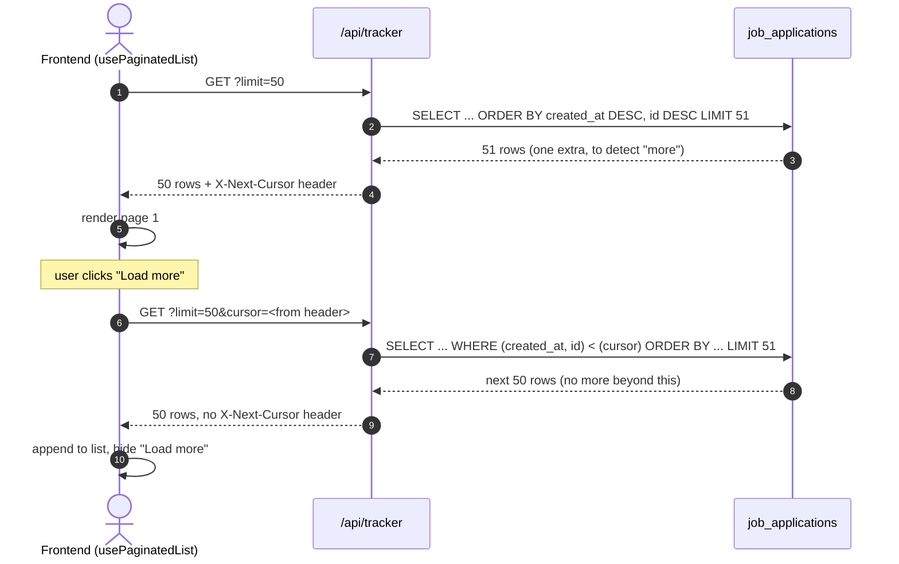
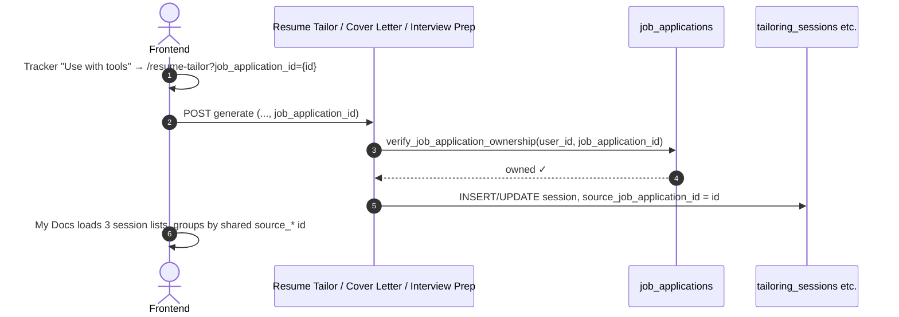

# Tracker: Data Flow & Schema Reference

**Document Version:** 1.0.0
**Status:** Approved for Production

---

## 1. Database Schema

### 1.1 `job_applications` (Tracker-owned — Applications tab only)

```sql
CREATE TABLE job_applications (
    id UUID PRIMARY KEY DEFAULT uuid_generate_v4(),
    created_at TIMESTAMPTZ NOT NULL DEFAULT now(),
    updated_at TIMESTAMPTZ NOT NULL DEFAULT now(),  -- trigger-managed
    user_id UUID NOT NULL REFERENCES profiles(id) ON DELETE CASCADE,
    company TEXT NOT NULL CHECK (char_length(company) <= 200),
    role TEXT NOT NULL CHECK (char_length(role) <= 200),
    applied_at DATE NOT NULL DEFAULT CURRENT_DATE,
    status TEXT NOT NULL DEFAULT 'Applied'
        CHECK (status IN ('Applied', 'Phone Screen', 'Interview', 'Offer', 'Rejected', 'Withdrawn')),
    follow_up_date DATE,
    notes TEXT CHECK (notes IS NULL OR char_length(notes) <= 3000),
    salary_min INTEGER,
    salary_max INTEGER
);
CREATE INDEX applications_user_id_idx ON job_applications(user_id);
CREATE INDEX applications_status_idx ON job_applications(status);
CREATE INDEX applications_follow_up_idx ON job_applications(follow_up_date);
```

"Overdue" is never a stored status — it's computed client-side
(`isOverdue(follow_up_date)`) whenever an active (not `Rejected`/
`Withdrawn`) application's `follow_up_date` has passed.

The Leads/Scout/Job Search tabs read `startup_hunt_opportunities`,
`startup_scout_companies`/`_contacts`, and `job_search_applications`
respectively — all documented in their owning modules'
`data_flow_and_schema.md`. Not repeated here.

### 1.2 Cross-Module Linkage Column (added this pass)

The same `source_job_application_id` column, same shape, added to all
three AI-tool session tables:

```sql
-- tailoring_sessions, cover_letter_sessions, interview_prep_sessions
ALTER TABLE <table> ADD COLUMN source_job_application_id UUID
    REFERENCES job_applications(id) ON DELETE SET NULL;
```

`ON DELETE SET NULL`, not `CASCADE` — the same reasoning as the two
pre-existing linkage columns on these tables
(`source_opportunity_id` → `startup_hunt_opportunities`,
`source_application_id` → `job_search_applications`): a generated
resume/letter/kit is still worth keeping if the user later deletes the
tracked application it was built for. It just becomes un-groupable.

My Docs' grouping key (`groupKeyFor` in `my-docs/page.tsx`) checks all
three columns:

```ts
function groupKeyFor(row: DocRow): string | null {
  if (row.sourceOpportunityId) return `opp:${row.sourceOpportunityId}`
  if (row.sourceApplicationId) return `app:${row.sourceApplicationId}`
  if (row.sourceJobApplicationId) return `job:${row.sourceJobApplicationId}`
  return null
}
```

---

## 2. Redis Keys

### 2.1 Rate Limiting (Applications tab)
- **Creation only**: `rl:{user_id}:tracker_create` —
  `rate_limit_tracker_create_per_day`. A storage-abuse ceiling, not
  AI-cost related.
- **Burst (every endpoint, including list)**:
  `rl_burst:{user_id}:tracker_list` / `tracker_create` / `tracker_update`
  / `tracker_delete`.

### 2.2 Pagination
No Redis involvement — the cursor is a plain encoded string
(`"<iso-timestamp>_<uuid>"`) passed back and forth in the query string
and response header; nothing about it is cached or stored server-side.

### 2.3 Leads/Scout/Job Search tabs
Use their owning modules' own Redis keys — see `docs/startup_hunt/`,
`docs/startup_scout/`, and `docs/recent_job_search/`'s own
`data_flow_and_schema.md` files.

---

## 3. Data Flow Diagrams

### 3.1 Add Application



### 3.2 Cursor-Paginated List + Load More



### 3.3 Generate-From-Tracker → My Docs Grouping


